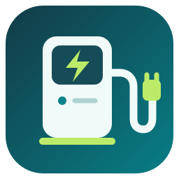

<p align="center"></p>

# ChargeX Aqueduct für Home Assistant

Lesende Community-Integration für ChargeX Aqueduct V1/V2 über Modbus TCP. Mehrere Ladesysteme lassen sich über die Home-Assistant-Oberfläche hinzufügen; ihre Ladepunkte werden automatisch als untergeordnete Geräte angelegt.

Die Integration liest ausschließlich Holding-Register (Modbus-Funktionscode 03). Sie bietet keine Ladesteuerung und verändert weder Ladefreigaben noch Leistungsvorgaben oder Charging Mode. Die HA-Aktion zur Umbenennung von Entity-IDs arbeitet nur in der lokalen Entity-Registry.

## Installation über HACS

Voraussetzungen: Home Assistant **2026.9.4 oder neuer**, installiertes HACS und ein von HA erreichbares Aqueduct-Startmodul mit Modbus TCP. Getestet mit Core 2026.9.4; spätere Versionen können zusätzliche Anpassungen erfordern.

1. In **HACS → Menü (⋮) → Benutzerdefinierte Repositories** öffnen.
2. `https://github.com/thanninger/chargex-home-assistant` hinzufügen, Typ **Integration**.
3. **ChargeX Aqueduct (lesend)** in HACS suchen und die aktuelle veröffentlichte Version herunterladen.
4. Home Assistant neu starten.
5. Unter **Einstellungen → Geräte & Dienste → Integration hinzufügen** nach **ChargeX** suchen.

HACS verwaltet anschließend die Dateien und bietet neue GitHub-Releases als Updates an. Nach einem Update Home Assistant neu starten. Dieses Repository ist ein benutzerdefiniertes HACS-Repository; eine Aufnahme in den Standardkatalog ist nicht erforderlich.

### Bereits manuell installiert?

Das Repository in HACS hinzufügen und herunterladen, danach HA neu starten. Die vorhandenen ChargeX-Konfigurationen nicht löschen. Integrationsdomain und Unique IDs bleiben gleich, deshalb werden die bestehenden Geräte und Entitäten wiederverwendet. HACS aktualisiert denselben Ordner `/config/custom_components/chargex`.

### Manuelle Installation

Aus einem Release den Ordner `custom_components/chargex` nach `/config/custom_components/chargex` kopieren. Kontrollieren, dass dort `manifest.json` liegt, anschließend HA neu starten. Die Integration ist keine HA-App.

## Einrichtung

Pro Ladesystem eine eigene Instanz hinzufügen:

| Feld | Beispiel / Standard |
|---|---|
| Name | Ladesystem A |
| Host | IP-Adresse oder Hostname des Startmoduls |
| TCP-Port | 1502 |
| Modbus Unit-ID | 10 |
| Abfrageintervall | 15 Sekunden |
| Ladepunktnamen | Ladepunkt 1, Ladepunkt 2 |

Die Modulanzahl wird ausgelesen. Eine optionale Namensliste muss genau einen Namen je Modul enthalten. **Index 0 ist das Startmodul**; die Zuordnung zu realen Parkplatznummern vor Ort prüfen. Gerätenamen können in HA angepasst werden. Individuell in HA vergebene Namen bleiben erhalten.

Die Geräteidentität verwendet die Systemseriennummer und je Ladepunkt den Modulindex. Nach physischer Umordnung von Modulen die Parkplatzzuordnung prüfen. Neue Module werden automatisch angelegt; nicht mehr vorhandene Module werden nicht verfügbar. Die Schnittstelle dokumentiert bis zu 15 Module pro System.

## Entitäten

| Ebene | Werte |
|---|---|
| Ladepunkt | Ladeleistung (W), Strom L1/L2/L3 (A), lädt gerade, Fahrzeug angeschlossen, Battery Full, autorisiert, Ladeanforderung, ein-/dreiphasiger Modus, Fehlerstatus, Fehlerbeschreibung, rohe Status-/Fehlerbits |
| System | Gesamtleistung, Strom L1/L2/L3, Mindestleistungsanforderung, angeschlossene Fahrzeuge, aktive Ladevorgänge, Modulanzahl, ladeberechtigte Module, Maximalstrom, Zähler- und Berechtigungszeitstempel |
| Systemeinstellungen, nur ausgelesen | Charging Mode, Zielleistung, Rückfallleistung, Zielleistungs-Timeout |
| Systemdiagnose | Phasenaufteilung, gemeldete Internetverbindung, Eichrechtsstatus, Zählerkonfiguration, Dry Contact, niedrige PV-Leistung, rohe Statusbits, optional rohe Systemfehlerbits |

Modell, Firmware und Seriennummer stehen in den Geräteinformationen. Diagnoseentitäten sind als Diagnose gekennzeichnet. Ein System mit zwei Modulen erhält 53 Entitäten inklusive der standardmäßig nicht verfügbaren Systemfehlerentitäten.

**Battery Full ist eine ChargeX-Bewertung, kein bestätigter Fahrzeug-SoC.** Niedriger Strom oder wiederholte Ladeverweigerung können diesen Status auslösen. Die dokumentierte Schnittstelle liefert keinen Akkustand in Prozent und keinen kumulierten Energiezähler in kWh.

„Lädt gerade“ stammt aus Statusbit 0 und „Fahrzeug angeschlossen“ aus Bit 3. Der Phasenmodus (Bit 1) wird auch bei nicht aktivem Laden angezeigt. Der systemweite Charging Mode ist 0 = Full control, 1 = Minimum charge, 2 = No reduction. Das System kann Grundverbrauch melden, während die Ladepunktleistungen 0 W sind.

Die gemeldete Internetverbindung beschreibt den ChargeX-Status, nicht die Erreichbarkeit zwischen HA und ChargeX. Ein nicht gesetztes Zählerkonfigurationsbit kann auch bedeuten, dass die Konfiguration nicht unterstützt wird.

## Entity-IDs

Neue IDs erhalten das Präfix `chargex_`, beispielsweise `sensor.chargex_ladepunkt_1_ladeleistung`. Existierende IDs bleiben beim Update erhalten.

Für vorhandene IDs ohne Präfix unter **Entwicklerwerkzeuge → Aktionen → YAML-Modus** zunächst eine Vorschau anfordern:

```yaml
action: chargex.prefix_entity_ids
data:
  apply: false
```

Zum Anwenden mit `apply: true` wiederholen. Die Aktion betrifft ausschließlich konfigurierte ChargeX-Entitäten, fügt das Präfix nur einmal hinzu und überspringt belegte Ziel-IDs. Nach dem Umbenennen bestehende Referenzen in Automationen, Templates und Dashboards prüfen. Die Aktion migriert keine Recorder-Datenbank; bestehende Historie kann unter der bisherigen ID weitergeführt werden.

## Zuverlässigkeit und Optionen

Abfrageintervall: 10–3600 Sekunden. Maximalalter der Zählermessung: 60–3600 Sekunden, Standard 180. Änderungen im Optionsdialog laden die Integration neu.

Einzelne Registeranfragen sind auf fünf Sekunden begrenzt, vollständige Aktualisierungszyklen auf 45 Sekunden. Anfragen laufen nacheinander auf der von HA verwalteten Verbindung. Bei Kommunikationsfehlern werden die Entitäten nicht verfügbar und die Verbindung für den nächsten Versuch recycelt. Ein unvollständiger Zyklus ersetzt keine bisherigen Messungen.

Neuere optionale Register werden separat gelesen. Nicht unterstützte Adressen oder Funktionen werden bis zum Neuladen übersprungen; temporäre Modbus-Ausnahmen im nächsten Zyklus erneut versucht. Betroffene Zusatzwerte führen dann keine alten Daten weiter.

Bei vorhandenem Zählerzeitstempel werden veraltete Leistungs- und Strommessungen nicht verfügbar. Das PDF beschreibt diesen Zeitstempel für Stromregister; die Verwendung auch für Leistung ist eine konservative Annahme. Statusflags haben keinen dokumentierten Aktualisierungszeitstempel. Ohne verwertbaren Zeitstempel wird nur die Kommunikation geprüft. Attribute zeigen `stale_check_supported` an.

### Unklare Fehlerregister

Das Hersteller-PDF widerspricht sich beim Systemfehlerregister: Dezimaladresse 62 in der Übersicht, Hexadresse 0x3F (=63) im Detail. Auch die Systemfehlerbits sind widersprüchlich beschrieben. Das Register bleibt standardmäßig deaktiviert. Im Optionsdialog lässt sich für Diagnosen Adresse 62 oder 63 wählen; dann werden nur rohe Bits und das Vorhandensein einer Fehlermaske angezeigt. Die Belegung vor produktiver Auswertung beim Hersteller verifizieren.

Ein beobachteter Modulfehlerwert `0xFFFFFFFF` ist nicht eindeutig dokumentiert. Er bleibt als Rohwert sichtbar, bekommt die Beschreibung „unbestätigt“ und macht den Fehler-Binary-Sensor nicht verfügbar. Er wird weder als „fehlerfrei“ noch als bestätigter Sammelfehler interpretiert.

## Diagnose und Tests

Über das Integrationsmenü lassen sich Diagnosedaten herunterladen. Host, Anlagenname, Ladepunktnamen und Seriennummer werden redigiert; Messwerte und Zeitstempel bleiben enthalten. Beim Teilen zusätzlich selbst prüfen, welche Betriebsdaten veröffentlicht werden sollen.

Die Tests nutzen echte Klassen aus HA 2026.9.4 und einen lokalen TCP-Simulator. Geprüft werden Registerdekodierung, optionale Register, Wiederverbindung, Verfügbarkeit, Geräteidentität, redigierte Diagnosen, Einrichtung, Optionen, Duplikate, Entladen und die Entity-ID-Umbenennung. Der Simulator bestätigt ausschließlich Funktionscode 03. Ein Aqueduct-2.0-System mit Firmware 2.3.2 wurde zusätzlich lesend geprüft; andere Firmwarestände können abweichen.

```sh
python3.14 -m venv .venv
.venv/bin/pip install -r requirements-test.txt
.venv/bin/python -m pytest -q
```

Für Änderungen: Versionsnummer im Manifest erhöhen, Tests ausführen, Änderungen committen und ein GitHub-Release mit passendem Tag (z. B. `v0.1.2`) veröffentlichen. Nur getestete Releases installieren; HACS bietet die Release-Versionen zur Aktualisierung an.

## Projekt und Icon

Inoffizielle Community-Integration, kein offizielles ChargeX-Produkt. Die Symbole wurden eigens für dieses Projekt gestaltet und sind kein Herstellerlogo. Vektorquellen liegen unter `assets/`, PNG-Dateien für helle und dunkle Oberflächen unter `custom_components/chargex/brand/`.

Grundlage: ChargeX „Modbus TCP Interface“ für Aqueduct V1/V2, Stand 2026.01. Das Hersteller-PDF und persönliche Anlagen-/Live-Testdaten sind nicht Bestandteil dieses Repositorys.

Referenzen: [Home Assistant Modbus](https://www.home-assistant.io/integrations/modbus/), [lokale Integrations-Icons](https://developers.home-assistant.io/docs/core/integration/brand_images/), [HACS-Repositories](https://www.hacs.dev/docs/faq/custom_repositories/).

Lizenz: MIT, siehe [LICENSE](LICENSE).
